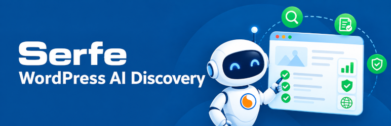

# Serfe AI Discovery

> Expose published WordPress content as clean Markdown and machine-readable discovery signals for AI agents, LLMs, and semantic search engines.

[](https://wordpress.org/)
[](https://php.net/)
[](LICENSE)

---



## Plugin Objective

Traditional SEO plugins optimize your website for search engines like Google and Bing. **Serfe AI Discovery** complements your SEO strategy by making your public content structured and discoverable for the **Agentic Web** (AI Agents, LLMs, and conversational engines).

By serving clean `.md` representations of your public content alongside machine-readable discovery endpoints (`robots.txt`, `llms.txt`, and RFC 9727 API Catalogs), the plugin bridges the gap between WordPress and AI consumers.

---

## What It Does

- **Clean Markdown Content**: Serves structured Markdown with YAML front matter for eligible public URLs via `.md` suffix or HTTP content negotiation (`Accept: text/markdown`).
- **RFC 8288 Link Headers**: Automatically advertises alternate Markdown versions, verified `llms.txt` (`rel="describedby"`), and XML sitemaps (`rel="related"`).
- **Machine-Readable API Catalog**: Exposes an optional RFC 9727 Linkset at `/.well-known/api-catalog` pointing to the WordPress REST API.
- **Root Discovery Management**: Provides safe, in-admin editing and validation for root `robots.txt` and `llms.txt`.
- **Agent Readiness Checks**: Offers bounded, read-only local diagnostics for AI and agent compatibility.

### Quick Example

```text
# Standard browser request:
https://example.com/sample-post/      → Returns HTML

# Explicit Markdown request:
https://example.com/sample-post.md    → Returns Markdown (Content-Type: text/markdown)
```

Content negotiation is also supported:

```bash
curl -H "Accept: text/markdown" https://example.com/sample-post/
```

Eligible pages include canonical HTML links in their headers:
```html
<link rel="alternate" type="text/markdown" href="https://example.com/sample-post.md">
```

---

## Requirements

- **WordPress:** 6.2 to 7.1 (all versions fully supported).
- **PHP:** 7.4 or higher (tested across PHP 7.4, 8.1, and 8.4).

---

## Supported Content

| Content Type | Exposure Details |
|---|---|
| **Posts & Pages** | Published posts, pages, and blog archives (with taxonomy and pagination). |
| **WooCommerce** | Public products, shop archives, categories, and tags (respecting price, stock, and visibility). |
| **Custom Post Types** | Publicly queryable CPTs and their archives. |

### Excluded by Default
- Drafts, private, password-protected, or non-public content.
- WooCommerce transactional pages (cart, checkout, account).
- Dynamic blocks, shortcodes, feeds, and embeds (only static, saved content is exposed).

---

## Usage & Settings

Access the plugin from the WordPress admin menu under **AI Discovery**:

- **Overview**: High-level status of active features, discovery files, and recent checks.
- **Markdown**: Instant master toggle to enable/disable Markdown publication. Includes **Advanced Settings** to exclude specific post types or exact URL paths (one per line).
- **Robots.txt & llms.txt**: 
  - Review and edit root discovery files directly.
  - Safe takeover mechanism with checksum verification when replacing virtual responses (e.g. from Yoast or Rank Math).
  - One-click automatic backup and rollback.
  - Read-only validator checking sitemap declarations and crawl policies.
- **API Catalog**: Enable or disable the RFC 9727 public API catalog linkset.
- **Help & Support**: Community support via GitHub and Serfe Professional Services (GEO Assessment consultation).

---

## Agents Discovery

Under **AI Discovery → Discovery**, administrators can run local, read-only capability checks without third-party network dependencies. Checks verify:
- Presence and formatting of `robots.txt` and `llms.txt`.
- XML Sitemap detection and Link headers.
- Markdown content negotiation (`Accept: text/markdown`).
- API Catalog and REST API availability.

### Extending Readiness Signals
Developers can register custom endpoints (such as Model Context Protocol or Agentic Commerce) via WordPress filters:

```php
// Register Model Context Protocol (MCP) endpoint
add_filter( 'serfe_agent_readiness_mcp', function () {
    return array(
        'endpoint'   => 'https://example.com/mcp',
        'health_url' => 'https://example.com/mcp/health', // Optional 2xx health check
    );
} );

// Register OAuth Protected Resource Metadata
add_filter( 'serfe_agent_readiness_oauth_protected_resource', function () {
    return array(
        'metadata_url' => 'https://example.com/.well-known/oauth-protected-resource',
    );
} );

// Register Agentic Commerce endpoint
add_filter( 'serfe_agent_readiness_agentic_commerce', function () {
    return array(
        'endpoint'   => 'https://example.com/agentic-commerce',
        'health_url' => 'https://example.com/agentic-commerce/health',
    );
} );
```

---

## Installation

1. In WordPress, go to **Plugins → Add New → Upload Plugin**.
2. Upload the `serfe-ai-discovery.zip` package.
3. Activate the plugin.
4. Go to **AI Discovery → Markdown** and turn on the master toggle.
5. Visit any public post with `.md` appended to verify.

---

## Safety & Routing

The plugin strictly enforces security and routing boundaries:
- Internal WordPress routes (`/wp-admin`, `/wp-json`, `/wp-content`, `/wp-includes`, `/xmlrpc.php`) are **never** routed as Markdown.
- Markdown responses include `X-Robots-Tag: noindex, follow` to prevent duplicate indexing in traditional search engines.
- Responses include `Vary: Accept` and estimated token metrics (`X-Markdown-Tokens`).
- Cache-Control defaults to `private, no-store` to prevent caching conflicts across shared CDNs.

---

## Collaboration & Support

Contributions are welcome!
- **Contributing**: Read [CONTRIBUTING.md](CONTRIBUTING.md) for guidelines and local verification steps.
- **Community Support**: Check [SUPPORT.md](SUPPORT.md) or open an issue on GitHub.
- **Security**: Report vulnerabilities privately following instructions in [SECURITY.md](SECURITY.md).

---

## Development & Testing

Run the self-contained test suites locally:

```bash
# Run unit & compatibility tests
for t in tests/*.php; do php "$t"; done

# WordPress Coding Standards (PHPCS)
vendor/bin/phpcs --standard=phpcs.xml.dist

# Static Analysis (PHPStan)
vendor/bin/phpstan analyse --configuration=phpstan.neon.dist --no-progress
```

For live HTTP checks against a running WordPress site:
```bash
tests/http-smoke.sh https://example.com/sample-post/
```

---

## Version

Current internal version: `1.0.11`. See [CHANGELOG.md](CHANGELOG.md) for full release notes.

---

## About Serfe

Serfe is a software development company that specializes in building high-quality, scalable web applications and integrations. We are committed to open-source and helping organizations embrace modern web standards, including the emerging Agentic Web.

Learn more at [serfe.com](https://www.serfe.com).

---

## License

This plugin is licensed under the [GNU General Public License v2.0 or later](LICENSE). The Serfe name and logos remain subject to their trademark rights.
